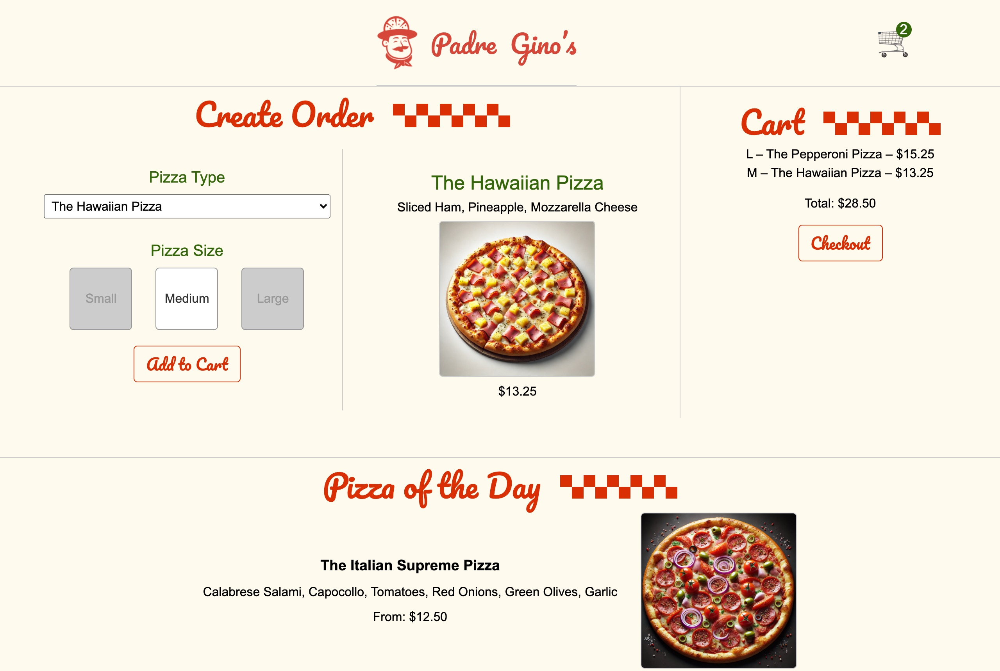
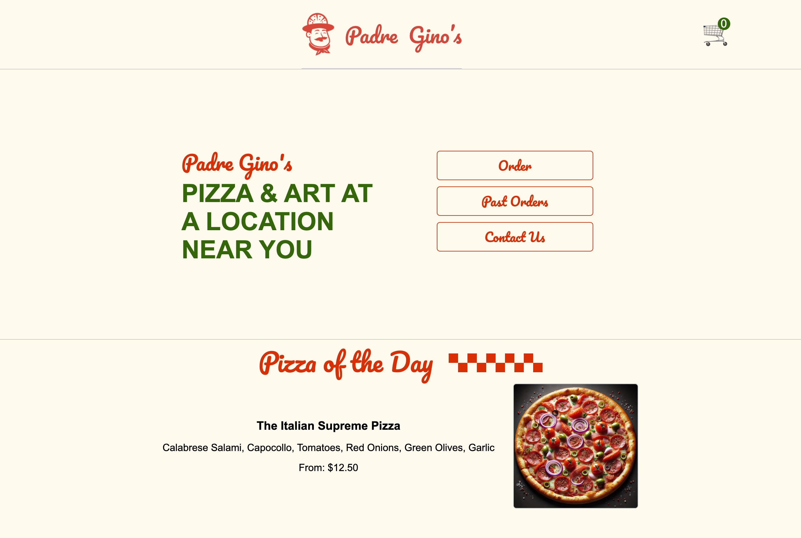

# Padre Gino's 🍕

[](https://github.com/Soheil86/padre-ginos/actions/workflows/ci.yml)

A pizza ordering app built with React 19. Pick a pizza and size, add it to your cart, check out, browse past orders and send a message through the contact form.

**Live demo: [padre-ginos-delta.vercel.app](https://padre-ginos-delta.vercel.app/)**

> The API runs on Render's free plan and sleeps when nobody is using it, so the first load can take about 30 seconds.





## Features

- **Order** – choose a pizza type and size, see the price, and add it to the cart. The cart totals your order, and the checkout button stays disabled until there's something in it.
- **Past orders** – a paginated list of previous orders. Click an order ID to see its pizzas in a modal.
- **Contact** – a form that shows "Sending…" while the message is on its way.
- **Pizza of the day** – shown on every page.

## Tech stack

| Area | Tools |
|---|---|
| UI | [React 19](https://react.dev) with the [React Compiler](https://react.dev/learn/react-compiler) for automatic memoization |
| Routing | [TanStack Router](https://tanstack.com/router) (file-based, lazy-loaded routes) |
| Data fetching | [TanStack Query](https://tanstack.com/query) |
| Build | [Vite](https://vite.dev) |
| Testing | [Vitest](https://vitest.dev), [Testing Library](https://testing-library.com), Vitest browser mode with [Playwright](https://playwright.dev) |
| Code quality | ESLint, Prettier |

### React features used

- `use()` with `<Suspense>` to load past orders, with an `<ErrorBoundary>` for failed requests
- Form actions (`<form action={...}>`) and `useFormStatus` for the contact form's pending state
- Context for the shared cart
- A portal-based `<Modal>`
- A custom hook (`usePizzaOfTheDay`)

## Getting started

### Prerequisites

- Node.js 20 or newer
- The API server, [padre-ginos-api](https://github.com/Soheil86/padre-ginos-api) (Fastify + SQLite). This repo only contains the frontend.

### 1. Start the API

```bash
git clone https://github.com/Soheil86/padre-ginos-api.git
cd padre-ginos-api
npm install
npm run dev
```

The API runs on `http://localhost:3000`.

### 2. Start the app

In a second terminal:

```bash
git clone https://github.com/Soheil86/padre-ginos.git
cd padre-ginos
npm install
npm run dev
```

Open `http://localhost:5173`. Vite forwards `/api` and `/public` requests to the API server.

## Scripts

| Command | What it does |
|---|---|
| `npm run dev` | Start the dev server |
| `npm run build` | Build for production into `dist/` |
| `npm run preview` | Serve the production build locally |
| `npm test` | Run the tests in watch mode |
| `npm run test:ui` | Open the Vitest UI |
| `npm run coverage` | Run the tests with a coverage report |
| `npm run lint` | Lint with ESLint |
| `npm run format` | Format `src/` with Prettier |

## Testing

Tests live in `src/__tests__/` and are split into two groups by file name (see `vitest.workspace.js`):

- `*.node.test.jsx` run in [happy-dom](https://github.com/capricorn86/happy-dom), a fast simulated browser.
- `*.browser.test.jsx` run in real Chromium through Playwright. Use these for anything that relies on real browser behavior, such as React form actions.

Before running the browser tests for the first time, install Chromium:

```bash
npx playwright install chromium
```

The tests mock `fetch`, so they don't need the API server running.

## Project structure

```
src/
├── routes/          # one file per page (TanStack Router file-based routing)
│   ├── __root.jsx   # layout: header, cart context, pizza of the day
│   ├── index.lazy.jsx
│   ├── order.lazy.jsx
│   ├── past.lazy.jsx
│   └── contact.lazy.jsx
├── api/             # fetch helpers for the API
├── __tests__/       # unit and browser tests
├── Cart.jsx
├── Pizza.jsx
├── Modal.jsx
├── ErrorBoundary.jsx
└── App.jsx          # router and query client setup
```


